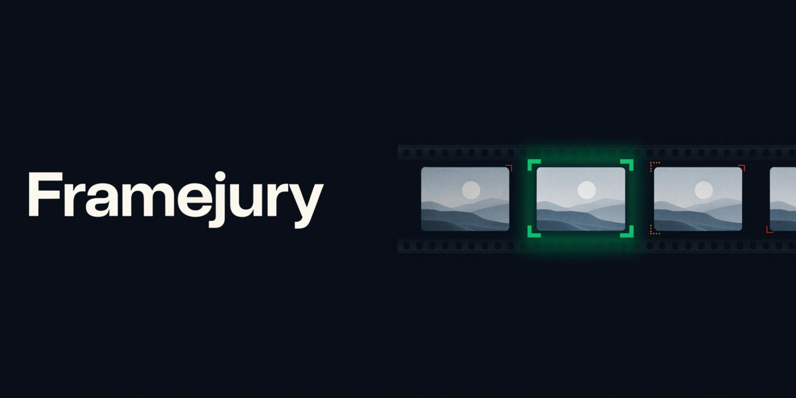

# Framejury

Framejury is a photo culling tool for event photographers that looks through a folder of photos, groups the shots that are nearly identical, picks the best one of each group and explains the choice in words you can read, check against the evidence and change with a single click. Everything runs on your own computer, which means your photos are never uploaded anywhere and the vision model that compares them runs locally through Ollama.

## Demo

A minute and a half with captions and no sound needed. [Watch it on YouTube](https://youtu.be/XVh0xfndIb4).

Sample photos in the demo are by Trougnouf (Benoit Brummer), from the 2023 ULB graduation ceremony, via Wikimedia Commons, under CC BY-SA 4.0.

## Why Framejury exists

After a wedding, a concert or a company event, a photographer comes home with thousands of frames, and a large share of them are bursts of the same moment, so choosing the good one becomes a slow, repetitive and tiring task that clients never see and rarely pay for directly, which makes every hour of it expensive.

Framejury takes care of the first pass instead of trying to replace the photographer's taste, because it removes the obvious losers, flags the close calls for a human look and explains each choice so that nothing feels like a black box.

## Why it runs on your computer

Client photos are private and an event photographer is often bound by a contract that says so, so sending thousands of images to a cloud service means trusting a third party with that material, paying for every image and depending on a provider that can change its prices or its rules whenever it wants.

Framejury avoids all three problems because the images stay on your disk, the model is an open weight model that you download once, and there is no fee per photo, and once the model is installed the tool keeps working even without an internet connection.

## How it decides

Framejury works in four steps, and only one of them uses a language model.

In the first step it measures every photo with ordinary image analysis, estimating sharpness from the amount of fine detail in the sharpest regions of the frame, checking whether highlights or shadows are clipped, computing a compact visual fingerprint and reading the capture time from the EXIF data.

In the second step it builds groups, so that photos taken within a short time of each other that also look alike end up together and you always compare a shot with its true alternatives, and both the time window and the similarity threshold are settings you can change.

In the third step it asks Gemma 4 to look at the sharpest candidates of each group, and the model does not make the final call because it only reports what it sees, such as whether anyone has closed eyes, how crisp the main subject is and whether an expression looks awkward. Each group is shown to the model twice in a different order, which reduces the chance that the position of a photo influences the answer.

In the fourth step plain and readable rules turn the measurements and the observations into a decision, so that every photo is kept, rejected or sent to review and the reason is written in sentences you can read, and close calls are never decided silently because they are marked for review so that a person makes the final choice.

Because the model only supplies observations and the rules make the decision, the behavior is predictable, and the rules live in `decision.py`, which is short enough to read in a few minutes.

## What you need installed

You need four things on the machine that will run Framejury. Python 3.10 or newer runs the engine that analyzes the photos, Node.js 20.9 or newer runs the web interface, Ollama runs the vision model and can be downloaded from `https://ollama.com`, and Git is needed to clone the repository.

A graphics card makes the vision step much faster, although Ollama also works on a processor alone, only more slowly, and the author developed Framejury on a laptop with an NVIDIA RTX 4050 that has 6 GB of video memory. If you choose to work without the model, the analysis relies only on measurements and finishes much more quickly.

## Installation

These steps use Windows PowerShell, and on macOS or Linux the commands are the same except for the way the virtual environment is activated, which is shown right after the commands.

Start by downloading the model, which needs an internet connection only this once because the file stays on your disk afterward.

```powershell
ollama pull gemma4:e4b-it-qat
```

Then clone the repository and set up the engine inside a virtual environment, so that its dependencies stay separate from the rest of your system.

```powershell
git clone https://github.com/carlosjcastro/framejury.git
cd framejury\backend
python -m venv .venv
.venv\Scripts\Activate.ps1
pip install -r requirements.txt
```

On macOS or Linux you activate the environment with `source .venv/bin/activate` instead of the activation script shown above.

Finally, install the web interface by moving to the frontend folder and installing its dependencies with npm.

```powershell
cd ..\frontend
npm install
```

At any moment you can check that Ollama and the model are ready by running the following command from the backend folder.

```powershell
python -m framejury check
```

## Running Framejury

Framejury has two parts that run side by side, so you will use two terminals, and you should make sure that Ollama is running before you begin, which on most systems happens automatically when the Ollama app is installed, and otherwise you can start it with `ollama serve`.

In the first terminal, start the engine from the backend folder with the virtual environment active.

```powershell
uvicorn framejury.api:app --host 127.0.0.1 --port 8000
```

In the second terminal, start the interface from the frontend folder.

```powershell
npm run dev
```

Then open `http://localhost:3000` in your browser, and if you want a faster and lighter interface you can run `npm run build` followed by `npm start` instead of `npm run dev`.

If you run the engine on a different port, you can tell the interface where to find it by setting the `NEXT_PUBLIC_API_URL` environment variable before starting the interface.

## Using the app

You paste the full path of a folder that contains your photos and choose Analyze folder, and because browsers are not allowed to pick folders on their own, the path has to be typed or pasted. If you only want some of the photos, you can choose Choose photos instead, tick the ones you want and optionally ask Framejury to compare your selection as a single group.

While the analysis runs you can follow each stage, the estimated time left and what the model is looking at, and you should expect the first call to the model to take longer than the following ones because the model has to be loaded into memory.

When the analysis finishes you get a review screen where the photos are shown group by group with a clear Keep, Review or Reject label and the reason behind it, and opening the evidence shows the measurements that led to the decision. If you disagree with a label you can change it, and Framejury remembers that the decision was yours, and you can also filter by decision, select several photos to change them together and read a short closing note written by the model that points out what deserves a second look.

## Choices you control

Nothing about the analysis is locked in, because under the advanced options you can choose which criteria are used, among sharpness, exposure, closed eyes, subject focus and expression, you can limit the file types to JPEG, PNG, WebP or RAW, include subfolders, skip files by pattern such as `*draft*` and pick a different model from the ones installed on your machine.

You can also tune the way Framejury groups and judges, since the time between shots, the visual similarity needed to share a group, the number of candidates the model compares at once and the strictness about soft shots are all adjustable, and the defaults are a sensible starting point, while the language of the reasons can be English or Spanish.

If you turn off every criterion that needs the model, or turn off the vision model itself, Framejury works from measurements alone and finishes much faster.

## Exporting your results

Framejury never moves or deletes your original photos, and when you export it works on copies or writes small companion files next to them.

You can download a CSV file that opens in any spreadsheet and lists every decision together with its reason and its measurements, you can copy the photos into Keep and Review folders next to your originals, with RAW and JPEG pairs and existing sidecar files traveling together, and you can write XMP sidecar files that carry a color label and a rating so that editing software can pick them up. This last option is experimental, because Lightroom and Bridge read sidecar files for RAW photos while Lightroom ignores them for JPEG files, and Framejury never overwrites a sidecar file that already exists.

There is also a command line mode for working without the interface, which you can use as shown below.

```powershell
python -m framejury analyze C:\photos\wedding --out results
python -m framejury analyze C:\photos\wedding --no-vision --recursive --exclude "*draft*"
```

The command writes a full report and plain lists of the photos to keep, reject and review into the output folder.

## Security and privacy

Framejury is designed as a personal tool that runs on one computer for one person, and its protections follow from that design.

Your photos are read from disk, analyzed in memory and shown through thumbnails that the local engine produces, and the only network traffic during an analysis happens between the engine and Ollama on your own machine, so the photos are never sent to a server on the internet. A few things do use the network outside of an analysis, because installing the dependencies downloads packages, pulling the model downloads it from Ollama, and building or starting the web interface downloads the Geist fonts from Google Fonts, and you can confirm that nothing leaves your machine during an analysis by watching the Network tab of your browser or your firewall.

When it is started as shown above, the engine listens only on the local address `127.0.0.1`, so other devices on your network cannot reach it, and it also refuses any request whose host name is not `localhost` or `127.0.0.1`, which closes the door on attacks that try to trick a browser into talking to a local service through a different name. Browsers are only allowed to read its answers from the local interface, and any request that changes something is refused when it comes from another website, so a page you happen to visit cannot read your results or trigger an analysis or an export.

Your originals are treated as read only, since the analysis never changes them, exports write copies and sidecar files are never overwritten, and thumbnail requests cannot use parent folder tricks to reach files outside the folder they refer to, while invalid or out of range settings are rejected or clamped before they are used.

The language model is limited by design, because it has no access to your files, to tools or to the network and it can only answer with a fixed structure of observations, while plain rules turn those observations into decisions and the model's own vote adds only a small bonus to a score. A photo that contains misleading text could still try to confuse the model, but the harm it can do is bounded to a slightly different ranking inside one group, which you can see and change. The closing note is checked against the facts of the report, and if the model mentions a file or a number that is not in the results, Framejury discards the note and writes a plain one from a template instead.

Some limits are worth knowing about, and the first one is that there is no login, because the tool is meant for a single trusted user, so anyone who can run commands on your computer can use the engine, and for that reason you should not expose port 8000 to a network or start the engine with a host other than `127.0.0.1`. Reports are stored as plain files in the `data` folder next to the engine and contain the paths and file names of your photos, so you should delete the files in that folder when a job is finished and keep that folder out of version control. Finally, the model can be wrong, so you should treat its observations as a strong hint and use the Review label as an invitation to look closely.

## Troubleshooting

If the page says that Framejury can't reach its engine, the backend is not running, so you should start it with the command in the running section and press Check again.

If the page says that Ollama isn't running, you can open the Ollama app or run `ollama serve`, and in the meantime you can choose to analyze without the model while you sort it out.

If the page says that the model isn't downloaded, you should run `ollama pull gemma4:e4b-it-qat` and check again.

If the page says that no photos were found, you should confirm the path and make sure that the file types and the subfolder setting in the advanced options match what is on disk.

If a few files are reported as unreadable, they are probably damaged or in a format that is not supported, and they are left out of the results while the list shows which ones they are.

If PowerShell refuses to activate the virtual environment because scripts are disabled, you can run `Set-ExecutionPolicy -Scope CurrentUser RemoteSigned` once and try the activation again.

If the analysis feels slow, keep in mind that comparing photos with a local model depends heavily on your graphics card and on the number of groups, and that lowering the number of candidates per group or turning the vision model off will make it faster.

## Honest limits

Framejury sees the world through a small local model and it has the weaknesses of one, since detecting closed eyes is harder when people wear glasses, turn their head or appear small in the frame, and the judgment of expressions is subjective. For RAW files Framejury reads the embedded preview image instead of developing the file, so its measurements describe the preview and not the full sensor data, and groups with many nearly identical frames depend on the time and similarity settings, which you may need to adjust for fast bursts or slow events.

For these reasons Framejury is a first pass and not a final editor, and it is at its best when it removes the clear failures quickly and leaves the difficult choices to you with all the evidence in front of you.

## Project structure

The repository has two folders, the `backend` folder, which holds the Python package called `framejury` with the analysis pipeline, the decision rules, the Ollama client, the exports and the API together with their tests, and the `frontend` folder, which holds the Next.js interface with its pages, its components and the small library that talks to the API.

The tests for the engine run with `python -m pytest` from the backend folder and they use a simulated Ollama connection, so they do not need the model to be installed, while the interface can be checked with `npm run lint` and `npx tsc --noEmit` from the frontend folder.

## Built with

The interface uses Next.js, React, TypeScript and Tailwind CSS, the engine uses Python, FastAPI, Uvicorn, OpenCV, Pillow, NumPy and rawpy, and the judgment step uses Gemma 4 served locally by Ollama, which is released under the Apache 2.0 license according to its model card.

Framejury was built for the DEV Hacktoberfest Open Source AI Challenge, in the Side Hustle week.

## Changes after the contest deadline

Framejury was built during the entry period of the DEV Hacktoberfest Open Source AI Challenge, which closed on October 18, 2026 at 11:59 PM PDT. Any commit made after that moment is listed here, so that the version that was submitted can be told apart from later work.

No commits have been made after the deadline yet.

## License

Framejury is released under the MIT License, which you can read in the `LICENSE` file, and the models that you run through Ollama keep their own licenses.
